# 开始建站

[← 返回首页](../README.md) · 上一步：[安装](01-install.md) · 下一步：[确定网站风格](03-style.md)

**这篇适合：** 已经装好 skill，准备让 AI 开始做网站的人。

## 先准备好这些资料

不用一次准备齐，缺的可以先空着，但**上线前必须换成真实资料**。

- **公司**：公司名称、一句话介绍、是工厂还是贸易公司、成立年份
- **产品**：产品名称、主要规格参数、用途；有产品目录或说明书更好
- **客户**：主要卖给哪些国家、什么样的客户（比如批发商、工程公司）
- **联系方式**：接收询盘的邮箱，可以加 WhatsApp 或电话
- **图片**：Logo、产品照片、工厂或团队照片（必须是你自己有权使用的）
- **参考网站**：2 到 3 个你喜欢的同行网站，用来定风格（见[确定网站风格](03-style.md)）
- **真实证明**：认证证书、展会、合作案例（没有就不写，不要编）

## 第一次跟 AI 这样说

叫出 skill 后，可以照着下面改一改发给它：

```text
我要做一个外贸网站。
公司：XX 机械有限公司，宁波的工厂，做工业水泵 15 年。
产品：离心泵、潜水泵、管道泵三大类，资料在 my-waimao-site/资料 文件夹里。
客户：主要卖给中东和东南亚的批发商、工程承包商。
网站语言：英文。
询盘邮箱：sales@xxx.com
参考网站：https://xxx.com 和 https://yyy.com，我喜欢它们简洁专业的感觉。
没有后台管理需求，先用默认方式做。
```

小技巧：把资料文件（Word、PDF、图片）放进 `my-waimao-site` 里的一个文件夹，告诉 AI 位置，比在对话框里打字更省事。

## AI 会问你“用哪种方式管理内容”

| 方式 | 适合谁 | 以后怎么改内容 |
| --- | --- | --- |
| **纯静态站（默认，推荐新手）** | 产品不常变，想最简单 | 告诉 AI 改哪里，改完重新发布 → [详细说明](content-static.md) |
| RXCMS 站 | 想要后台自己改内容，或需要站内询盘表单、图片视频托管 | 在 RXCMS 后台改 → [详细说明](content-rxcms.md) |
| WordPress 站（实验） | 已经有 WordPress 后台 | 在 WordPress 后台改 → [详细说明](content-wordpress.md) |

**不知道选哪个，就说“用默认方式”。** 以后需要了还可以换。

发布平台现在不用决定。到了发布那一步，AI 会推荐用 Cloudflare（免费版就够用，公司网站也可以用）；Vercel 也有免费版，但只限个人非商业用途，公司网站按条款要用付费版，可以按自己的情况选择。

## 要做几种语言



默认只做英文。想面向更多国家的客户，直接告诉 AI：

```text
网站要做英语、德语、西班牙语三种语言，英语是主语言。
```

AI 会帮你做好这些：

- **每种语言有独立网址**：英语在 `yoursite.com/`，德语在 `yoursite.com/de/`，西班牙语在 `yoursite.com/es/`，Google 可以分别收录
- **网页上的按钮、菜单、表单、Cookie 提示**都翻译成对应语言
- **页头有语言切换按钮**，访客可以随时切换（某个页面还没有对应语言时，会切到那种语言的首页，这是正常的）
- **告诉 Google 各语言版本的对应关系**，让德国客户搜到德语页、西班牙客户搜到西语页

你需要注意：

- **产品和文章要有对应语言的内容。** AI 可以先帮你翻译，但产品参数、专业术语最好请懂这门语言的人核对一遍。
- **某个产品还没有德语版，德语网站就暂时不显示这个产品**，不会拿英文内容冒充德语页面。翻译好了再告诉 AI 加上。
- **以后想加新语言**，随时告诉 AI“再加一个法语”就行。
- 现在多语言适用于默认的纯静态站。用 RXCMS 后台的多语言网站，开通时请作者协助接入；用 WordPress 后台的多语言网站也需要单独接入，并按你的 WordPress 所用的多语言插件适配。

## AI 做完后你会得到什么

- 一个以**公司英文名**命名的文件夹（例如 `my-waimao-site/huali-pumps/`），里面就是你的网站。这个名字以后也是 GitHub 上的仓库名，AI 会根据公司名起好并先告诉你，想换名字当场说就行
- 一个本机预览网址（一般是 `http://localhost:4321`）：AI 做完会自己打开预览并把网址发给你，点开就能看到网站。如果 AI 只给了你一段命令，直接回它一句“请你帮我启动预览”
- 网站自己的说明文件 `README.md`，记录了你选的方式和以后怎么更新
- AI 会告诉你：已经做了什么、还缺哪些资料、哪些需要你确认
- 一个 `brief` 文件夹，专门记下**你的长期要求**：品牌风格、文案语气、产品怎么展示、图片偏好、哪些不能写等。你以后提的长期要求（比如“文案要更专业”“图片不要出现人”），AI 都会记进去，下次修改网站时自动遵守，不用你反复交代

**AI 怎么记得这些要求？** 网站文件夹里有 `AGENTS.md` 和 `CLAUDE.md` 两个说明文件，Claude Code、Codex 等支持这类说明文件的 AI 工具打开项目时会自动读取，里面提醒 AI 先看 `brief` 里的要求（其他 AI 工具以它自己的设置为准，不确定时对它说一句“先看网站里记下的我的要求”）。这几个文件不用你动，也不要删。

**注意：** 这时网站只是在你电脑上生成了文件，**还没有上线**，别人看不到。

## 完成标志

网站文件夹（如 `my-waimao-site/huali-pumps/`）里有 `package.json` 和 `README.md`，AI 告诉你已经完成第一版。

下一步：[确定网站风格](03-style.md)，或直接[预览和修改](04-preview.md)
