# SEO：让 Google 搜到你的网站

[← 返回首页](../README.md) · 相关：[注册域名并绑定](09-domain.md)

**这篇适合：** 网站已经上线，想让海外客户在 Google 上搜到的人。

## 站内技术 SEO：建站时一并搞定



**站内技术 SEO 不用再另外请人做。** 这个 skill 从建站到站内技术 SEO 一套完成：AI 做网站时会自动做好下面这些，你不需要另外安装工具，也不需要请 SEO 人员来“做优化”：

| 自动做好的 | 有什么用 |
| --- | --- |
| 每页独立的标题和描述 | Google 搜索结果里显示的标题和那两行简介 |
| 网站地图（sitemap.xml） | 告诉 Google 网站有哪些页面 |
| robots.txt | 告诉搜索引擎可以抓取哪些页面 |
| 规范网址（canonical） | 避免同一页面有多个网址被当成重复内容 |
| 结构化数据 | 让 Google 看懂哪里是公司信息、哪里是产品、哪里是文章 |
| 面包屑数据 | 搜索结果里可能显示“首页 › 产品 › 某产品”的路径 |
| 网站小图标、分享图 | 搜索结果和社交分享时显示（需要你提供 Logo 和图片，见[确定网站风格](03-style.md)） |
| 真实的 404 页面 | 打不开的网址如实告诉 Google，不影响收录 |
| 多语言标注（hreflang） | 告诉 Google 各语言版本的对应关系，让德国客户看到德语页、西班牙客户看到西语页 |
| 页面结构 | 每页一个主标题、清楚的标题层级、内容直接写在网页里，Google 能读到 |

不会做的事：编造价格、编造客户评价来骗搜索结果展示，这样做反而会被 Google 惩罚。

## 上线后你要做的两件事

### 第一件：打开“允许收录”

为了不让示例内容被 Google 收录，网站默认是**不允许收录**的。等这些都完成了：

- [ ] 示例产品和演示文字都换成了真实内容
- [ ] 已经绑定自己的域名（见[注册域名并绑定](09-domain.md)）
- [ ] 隐私页按公司实际情况补充好了

再告诉 AI：

```text
资料都已经是真实的了，正式域名是 https://www.yourcompany.com，请开启 Google 收录。
```

AI 改好后，你 Commit、Push 重新发布。页面底部的 “Demonstration website” 提示会同时消失。

### 第二件：提交到 Google Search Console

Search Console 是 Google 官方的免费工具，用来告诉 Google “我有一个新网站”，以后也能在这里看网站被搜到了多少次。

1. 用 Google 账号打开 [Google Search Console](https://search.google.com/search-console/)，点**添加资源**，选**网域**，填你的域名（不带 `https://`，比如 `yourcompany.com`）。
2. Google 会给你一条 **TXT 记录**。到管理你域名 DNS 的地方（域名商，或 Vercel / Cloudflare 的 DNS 设置）添加这条记录。**不要改动其他已有的记录。**拿不准在哪加，就问 AI。
3. 回到 Search Console 点**验证**。没通过就等一会儿再试，DNS 生效需要时间。[官方说明](https://support.google.com/webmasters/answer/9008080?hl=zh-Hans)
4. 验证成功后，点左侧**站点地图**，输入 `https://www.yourcompany.com/sitemap.xml`（换成你的域名），点提交。[官方说明](https://support.google.com/webmasters/answer/7451001?hl=zh-Hans)

**完成标志：** 站点地图的状态显示“成功”。

**别着急：** 提交成功只说明 Google 知道了你的网站，收录一般要几天到几周，排名更需要时间和持续的优质内容。

## 你能做的提升

站内技术 SEO 已经帮你把路铺好，接下来真正带来客户的是内容：

- **产品页写详细**：型号、参数、材质、用途、包装、起订量，采购商就是用这些词在搜
- **用客户的语言**：写客户会搜的词，比如 “submersible pump for irrigation”，而不只是 “XP-200”
- **真实照片**：工厂、车间、质检、包装、展会照片
- **定期写文章**：比如“如何选择合适的水泵”“我们的质检流程”，回答客户真正关心的问题
- **不要抄**：别复制同行或网上的文字，也不要批量生成只换了国家名的页面

随时可以对 AI 说“帮我检查一下网站的 SEO”，它会按内置规则检查并给出修改建议。

> 💡 **持续写文章最难坚持？** 很多外贸网站上线后，文章栏目就再也没更新过，排名也一直上不去。作者团队提供 **外贸 SEO 代运营**，内容和外链都交给我们，你专心接询盘。详见文末 [外贸 SEO 代运营](#想把排名做上去外贸-seo-代运营)。

## 站内技术 SEO 之外的事

站内技术 SEO 搞定，只是让 Google 能顺利读懂、收录你的网站。排名高低还取决于下面这些，它们不属于建站本身：

- **关键词研究、竞争对手分析**：需要专门的数据工具
- **持续的内容运营**：定期发布产品资料和行业文章
- **站外推广**：外链建设、社媒、B2B 平台引流

## 想把排名做上去：外贸 SEO 代运营

网站建好、技术 SEO 做到位之后，排名靠的是**持续、专业的内容**和**高质量的外链**。这两件事最花时间，也最需要经验。**外贸 SEO 代运营**是作者团队提供的服务，内容和外链都交给我们来做，你专心接询盘、做生意。

**我们为你做什么：**

| 服务 | 你得到的效果 |
| --- | --- |
| **关键词与市场调研** | 搞清楚海外采购商用什么词在找你的产品，找准值得做的方向 |
| **网站规划** | 产品页、分类页、文章栏目怎么布局，一开始就按 SEO 规划好 |
| **专业 SEO 内容** | 持续产出采购商真正在搜的专业文章，以及首页、产品页文案。内容有依据、讲得透，采购商读完觉得你懂行，愿意发询盘 |
| **多语言内容** | 面向不同市场产出对应语言的内容，覆盖更多国家的客户 |
| **外链建设** | 用正规方法为网站建设高质量外链，提升网站在 Google 眼里的权威度，不用会被 Google 惩罚的手段 |
| **发布与维护** | 内容直接发布到你的网站，并根据效果持续更新优化 |
| **效果报告** | 定期告诉你做了什么、带来了什么变化 |

**我们的原则：**
- **不编造**：产品参数、认证、产能、客户案例只用你公司的真实资料，不给品牌留隐患
- **重质量**：每篇内容发布前都经过严格审核，不做 AI 随手生成的“水文”
- **图文并茂**：内容配有清晰的说明图和图表，也会用上你的真实产品和工厂照片

**怎么合作：** 加作者微信说明你的产品和目标市场 → 我们评估后给出方案和报价 → 你提供公司和产品资料 → 我们持续产出内容、建设外链，并定期汇报。

**适合谁：** 刚建好网站、想尽快开始做 SEO 的外贸企业；已经有网站，但文章长期不更新、排名上不去的企业；没有时间或团队自己做 SEO 的企业。

> SEO 需要时间积累，正规的 SEO 服务都**不会承诺具体排名**。排名还受行业竞争、网站历史等因素影响，我们会如实汇报进展。

想了解服务和报价，[扫码添加作者微信](../README.md#联系作者)，备注“SEO 代运营”。
